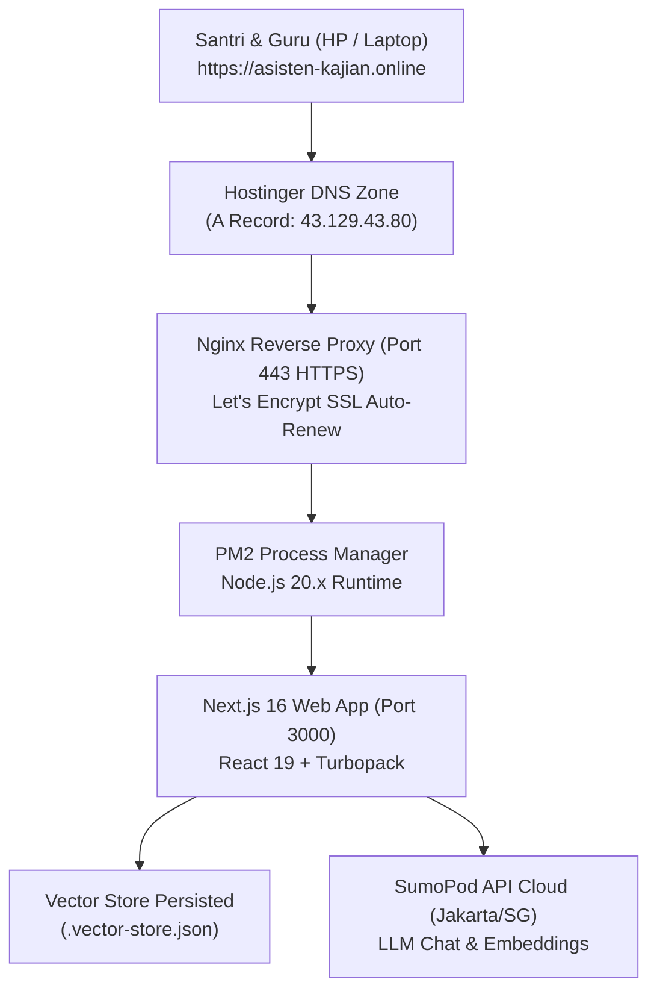

# Dokumentasi Arsitektur, Hosting & Status Live Produksi
**Proyek:** Asisten Kaji Kitab & Turats  
**Target Pengguna:** Dewan Guru/Ustadz dan Santri/Siswa Pesantren  
**Penyusun:** Tim Rekayasa Sistem & AI  
**Tanggal Eksekusi:** 12 Oktober 2026  
**Status Implementasi:** **100% SUKSES & LIVE PRODUCTION**  
**Alamat Resmi:** [https://asisten-kajian.online](https://asisten-kajian.online) (dan `https://www.asisten-kajian.online`)

---

## 1. Ringkasan Status Produksi (Live System)

Aplikasi *Asisten Kaji Kitab & Turats* kini telah berhasil dipublikasikan dan beroperasi penuh secara mandiri di cloud infrastructure. Seluruh guru, santri, dan dewan juri dapat mengakses sistem secara aman melalui protokol terenkripsi (HTTPS).

| Parameter | Konfigurasi Live |
| :--- | :--- |
| **URL Produksi** | **[https://asisten-kajian.online](https://asisten-kajian.online)** |
| **IP Publik Server** | `43.129.43.80` |
| **Penyedia VPS** | SumoPod Cloud (Tencent Infrastructure, Region Jakarta — Indonesia) |
| **Sistem Operasi** | Ubuntu Server 24.04 LTS (64-bit) |
| **Spesifikasi Server** | 2 vCPU, 2 GB RAM Fisik + 3.9 GB Virtual Swap Memory (Total ~5.9 GB) |
| **Penyimpanan** | 40 GB NVMe Storage |
| **Process Manager** | PM2 v7.0.4 (`asisten-kaji-kitab` — Auto restart on boot via systemd) |
| **Web Server / Reverse Proxy** | Nginx (Max client body size 60 MB untuk dokumen kitab) |
| **Keamanan SSL / TLS** | Let's Encrypt Authority X3 (Auto-renew aktif via Certbot) |
| **Provider AI Aktif** | SumoPod AI (`gpt-4o-mini` & `text-embedding-3-small`) |
| **Status Korpus Kitab** | 4 Kitab Inti Terindeks (*Safinatun Najah*, *Fathul Qarib*, *Ta'limul Muta'allim*, *Al-Kawakib Ad-Durriyyah*) |

---

## 2. Arsitektur Teknis Sistem Produksi



### A. Alur Permintaan Pengguna
1. Santri/Guru mengakses `https://asisten-kajian.online`.
2. Hostinger DNS mengarahkan domain ke IP `43.129.43.80`.
3. Nginx menerima koneksi port 443 dengan sertifikat SSL Let's Encrypt yang sah (gembok hijau). Jika pengguna mengetik `http://`, Nginx otomatis melakukan redirect ke `https://`.
4. Nginx meneruskan request ke aplikasi Next.js internal di `http://127.0.0.1:3000`.
5. PM2 menjaga aplikasi tetap menyala tanpa jeda (downtime).

---

## 3. Catatan Eksekusi & Konfigurasi Server

### A. Optimalisasi Memori (Swap 4 GB)
Dibuat swap file 2 GB yang digabungkan dengan swap bawaan:
```bash
sudo fallocate -l 2G /swapfile && sudo chmod 600 /swapfile && sudo mkswap /swapfile && sudo swapon /swapfile && echo '/swapfile none swap sw 0 0' | sudo tee -a /etc/fstab
```
*Hasil:* Kapasitas memori server meningkat menjadi ~5.9 GB, mencegah risiko *Out of Memory* saat kompilasi atau saat puluhan santri mengunggah PDF bersamaan.

### B. Otomasi PM2 (Zero Downtime)
Aplikasi didaftarkan dengan nama `asisten-kaji-kitab`:
```bash
pm2 start npm --name "asisten-kaji-kitab" -- start -- -p 3000
pm2 save
pm2 startup systemd
```

### C. Konfigurasi Nginx Reverse Proxy
Konfigurasi file `/etc/nginx/sites-available/default`:
```nginx
server {
    server_name asisten-kajian.online www.asisten-kajian.online;
    client_max_body_size 60M;

    location / {
        proxy_pass http://127.0.0.1:3000;
        proxy_http_version 1.1;
        proxy_set_header Upgrade $http_upgrade;
        proxy_set_header Connection "upgrade";
        proxy_set_header Host $host;
        proxy_set_header X-Real-IP $remote_addr;
        proxy_set_header X-Forwarded-For $proxy_add_x_forwarded_for;
        proxy_set_header X-Forwarded-Proto $scheme;
    }
}
```

### D. Sertifikat SSL Let's Encrypt (Certbot)
Sertifikat diaktifkan untuk kedua domain:
```bash
sudo certbot --nginx -d asisten-kajian.online -d www.asisten-kajian.online
```
*Status:* Berhasil diterbitkan dan terpasang dengan konfigurasi auto-redirect HTTP ke HTTPS. Masa berlaku diperbarui otomatis oleh daemon Certbot setiap 60 hari.

---

## 4. Panduan Pemeliharaan (Maintenance Cheatsheet)

Jika di kemudian hari ada pembaruan kode dari GitHub:

### Cara Melakukan Update Kode di Server:
1. Buka Web Console VPS atau SSH ke server.
2. Masuk ke folder proyek:
   ```bash
   cd ~/asisten-kaji-kitab
   ```
3. Tarik pembaruan kode:
   ```bash
   git pull origin master
   ```
4. Build ulang dan restart PM2:
   ```bash
   npm run build
   pm2 restart asisten-kaji-kitab
   ```
   *(Hanya butuh waktu sekitar 15 detik dan aplikasi langsung terupdate tanpa memutus koneksi pengguna).*

### Cara Memeriksa Log & Kesehatan Server:
* Cek status proses: `pm2 status`
* Cek log percakapan/error: `pm2 logs asisten-kaji-kitab`
* Cek penggunaan RAM: `free -h`
