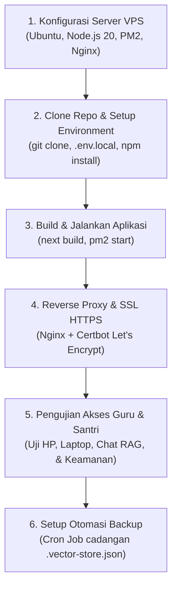

# Rencana Arsitektur, Kebutuhan & Hosting Website
**Proyek:** Asisten Kaji Kitab & Turats  
**Target Pengguna:** Dewan Guru/Ustadz dan Santri/Siswa Pesantren  
**Penyusun:** Tim Rekayasa Sistem & AI  
**Tanggal:** 12 Oktober 2026  
**Status:** Dokumen Perencanaan (Planning Phase — Menunggu Persiapan & Eksekusi)

---

## 1. Identifikasi & Analisis Arsitektur Sistem

Berdasarkan hasil audit menyeluruh pada basis kode saat ini, berikut adalah karakteristik teknis aplikasi:

### A. Komponen Frontend & Web Framework
* **Framework:** Next.js 16 (App Router) + React 19 + TypeScript.
* **Styling:** Tailwind CSS v4 (Desain *Islamic Scholar Workstation*, responsif desktop dan mobile).
* **Perilaku Client:** Single Page Application interaktif dengan 3 modul utama:
  1. *Kaji Kitab & Turats* (Chatbot RAG & Multimodal Vision).
  2. *Muraja'ah Hafalan* (Kuis ayat & matan terstruktur).
  3. *Korpus Literatur* (Manajemen dokumen & status indeks naskah).
* **Ekstraksi PDF:** Library `unpdf` untuk digital text extraction, serta `html2pdf.js` untuk ekspor telaah ke PDF santri.

### B. Komponen Backend & Pipeline AI
* **Endpoint API Next.js:**
  * `/api/chat`: Orkestrasi prompt RAG, pemanggilan LLM, dan transkripsi vision naskah kitab.
  * `/api/rag`: Ingest dokumen (PDF & Gambar), text chunking (800 karakter, overlap 150), embedding, dan cosine similarity search.
  * `/api/ai-status`: Pemantauan status live provider AI yang aktif.
* **Penyedia AI (Model Engine):**
  * **Provider Utama 1 (SumoPod / OpenAI-Compatible):**
    * Chat LLM: `gpt-4o-mini` (atau model kompatibel OpenAI lainnya).
    * Embeddings: `text-embedding-3-small` (wajib untuk indexing PDF & pencarian kemiripan vektor).
  * **Provider Cadangan 2 (Google Gemini API):**
    * Model: `gemini-2.0-flash` (mendukung chat bahasa Arab dan analisis gambar naskah kitab secara native).
  * **Fallback Mode (Simulasi / Mock):**
    * Jika API key tidak diatur atau kuota habis, sistem tetap berjalan menggunakan respons turats terstruktur bawaan tanpa *crash*.

### C. Karakteristik Penyimpanan Data (Storage & Database)
* **Basis Vektor:** Menggunakan file lokal persisted [`.vector-store.json`](file:///d:/Documents/asisten-kaji-kitab/.vector-store.json) (~877 KB, sudah memuat 4 korpus kitab kurikulum inti: *Safinatun Najah*, *Fathul Qarib*, *Ta'limul Muta'allim*, dan *Al-Kawakib Ad-Durriyyah*).
* **Sifat Penyimpanan:** Berbasis disk lokal (`fs.writeFileSync`). Dokumen yang diunggah santri/guru di masa depan akan langsung di-index dan disimpan ke file JSON tersebut.
* **Implikasi Hosting:** **Tidak cocok di-host pada platform Serverless murni (seperti Vercel Free)** yang memiliki *ephemeral filesystem* (di mana file yang diunggah akan hilang terhapus otomatis saat server *restart* atau *redeploy*). **Sangat ideal di-host pada VPS (Virtual Private Server)** dengan disk persisten.

---

## 2. Perbandingan & Pilihan Strategi Hosting

Terdapat 3 opsi pendekatan hosting untuk lingkungan pesantren:

| Parameter | Opsi 1: VPS Linux Cloud (Rekomendasi Utama) | Opsi 2: Server Lokal di Pesantren (Mini PC / Lab Server) | Opsi 3: PaaS Cloud (Vercel / Railway + Database Eksternal) |
| :--- | :--- | :--- | :--- |
| **Deskripsi** | Sewa server virtual di cloud (Ubuntu Server) | Komputer server fisik ditaruh di lab/kantor pesantren | Web di Vercel, Vector DB dipindah ke Pinecone / Supabase |
| **Aksesibilitas** | Dapat diakses 24/7 dari mana saja (HP santri di asrama, laptop guru di rumah). | Sangat cepat jika via WiFi lokal pesantren. Akses dari luar butuh IP Publik / Cloudflare Tunnel. | 24/7 global, namun butuh refaktor kode untuk memindahkan vector store ke cloud DB. |
| **Ketergantungan Listrik/Net** | 100% stabil di data center (SLA 99.9%). | Bergantung pada listrik pesantren & kestabilan internet sekolah. | Bergantung pada kuota platform cloud. |
| **Biaya** | Terjangkau (Mulai Rp 50.000 – Rp 150.000 / bulan). | Modal awal beli PC/Mini PC (Rp 2 - 4 juta), tanpa biaya sewa bulanan. | Ada tier gratis, tapi berisiko limit dan butuh konfigurasi database terpisah. |
| **Kompatibilitas Kode Saat Ini** | **100% Langsung Jalan** tanpa perlu mengubah kode `vectorStore.ts`. | **100% Langsung Jalan** tanpa perlu mengubah kode. | Butuh perubahan arsitektur kode. |

> [!TIP]
> **Rekomendasi Terbaik:** Gunakan **Opsi 1 (VPS Linux Cloud)** karena kode saat ini langsung kompatibel 100% tanpa modifikasi, biaya sangat terjangkau, dan dapat diakses fleksibel oleh santri maupun dewan asatidz kapan saja.

---

## 3. Spesifikasi & Kebutuhan Teknis (Requirements)

### A. Kebutuhan Server (Spesifikasi VPS)
Karena proses inferensi model AI berat ditangani oleh Cloud API (SumoPod / Google Gemini), VPS hanya bertugas menjalankan runtime Next.js, mem-parsing PDF, dan melakukan pencarian vektor in-memory:

* **Sistem Operasi:** Ubuntu 22.04 LTS atau Ubuntu 24.04 LTS (64-bit).
* **Processor (vCPU):** Minimal 1 vCPU (Disarankan **2 vCPU** untuk kenyamanan parsing PDF bersamaan).
* **Memori RAM:** Minimal 2 GB (Disarankan **4 GB RAM** + 2 GB Swap file agar proses kompilasi `next build` dan parsing PDF tidak terkena *Out of Memory*).
* **Penyimpanan (Storage):** Minimal 20 GB – 40 GB SSD / NVMe (Sangat cukup untuk OS, Node.js, file PDF kitab, dan backup vector store).
* **Bandwidth:** 1 Gbps Shared / Kuota minimal 500 GB – 1 TB per bulan.

**Rekomendasi Penyedia VPS Terjangkau & Stabil:**
1. **Penyedia Lokal Indonesia (Latency Rendah untuk Santri):**
   - *IDCloudHost* (Paket Cloud VPS mulai ~Rp 60.000 - Rp 120.000 / bulan)
   - *Biznet Gio* (Paket NEO Lite / VirtualBox)
   - *Niagahoster / DomaiNesia* (Paket Cloud VPS KVM)
2. **Penyedia Global:**
   - *Hetzner Cloud* (Paket CX22 / CPX21 ~€4 - €8 / bulan — performa sangat tinggi)
   - *DigitalOcean* (Droplet Basic 2GB RAM ~$12 / bulan)

### B. Kebutuhan Model AI (Inference Engine)
Pilih salah satu dari kombinasi berikut:

* **Pilihan A (SumoPod AI — Terpasang Saat Ini):**
  - Butuh: `SUMOPOD_API_KEY` aktif dengan saldo token yang memadai.
  - Model: `gpt-4o-mini` (Chat) dan `text-embedding-3-small` (Vektor).
* **Pilihan B (Google Gemini API — Alternatif Sangat Ekonomis):**
  - Butuh: `GEMINI_API_KEY` dari Google AI Studio ([aistudio.google.com](https://aistudio.google.com)).
  - Model: `gemini-2.0-flash` (Gratis tier harian yang cukup besar untuk kebutuhan uji coba pesantren, respons sangat cepat).
* *Catatan tentang Self-Hosted LLM (Ollama / VLLM di VPS):*
  - **TIDAK disarankan** di awal, karena menjalankan model LLM lokal membutuhkan VPS ber-GPU (sewa minimal $40 - $80/bulan) atau RAM 32 GB+. Menggunakan Cloud API jauh lebih hemat dan berkualitas tinggi untuk telaah teks Arab klasik.

### C. Kebutuhan Jaringan & Domain
1. **Nama Domain:**
   - Subdomain resmi pesantren (Contoh: `turats.pesantrenkita.ponpes.id` atau `kaji-kitab.pesantrenkita.sch.id`).
   - Atau domain khusus (Contoh: `.my.id` seharga ~Rp 15.000/tahun, atau `.com` / `.id`).
2. **DNS Management:** Cloudflare (Gratis, menyediakan proteksi DDoS, caching, dan manajemen DNS cepat).
3. **Sertifikat SSL:** Let's Encrypt (Gratis selamanya, auto-renew via Certbot).

---

## 4. Daftar Hal yang Harus Dipersiapkan (Checklist Pengguna)

Sebelum kita melakukan eksekusi instalasi, berikut adalah item yang perlu disiapkan oleh pengguna:

- [ ] **1. Akun & Mesin VPS:**
  - Telah memiliki akses ke 1 mesin VPS Ubuntu (IP Publik, Username `root` atau `sudo`, dan Password / SSH Key).
- [ ] **2. Domain / Subdomain:**
  - Satu nama domain atau subdomain yang DNS A Record-nya sudah diarahkan ke alamat IP Publik VPS.
- [ ] **3. Kunci API AI (Pilih salah satu atau keduanya):**
  - Saldo/Token `SUMOPOD_API_KEY`, atau
  - Kunci `GEMINI_API_KEY` dari Google AI Studio.
- [ ] **4. Repositori Git:**
  - Repositori proyek siap di-*clone* ke VPS (bisa melalui GitHub private repo menggunakan Personal Access Token atau SSH Key).

---

## 5. Rencana Langkah Eksekusi (Roadmap Deployment)

Ketika Anda sudah siap dan memberikan instruksi untuk mengeksekusi, langkah-langkah yang akan kita jalankan adalah sebagai berikut:



### Rincian Per Tahap:

#### Tahap 1: Persiapan Server VPS & Keamanan Dasar
1. Login SSH ke VPS.
2. Pembaruan paket sistem: `apt update && apt upgrade -y`.
3. Instalasi runtime yang dibutuhkan:
   - Node.js LTS (versi 20.x atau 22.x).
   - Git.
   - Nginx (Web Server & Reverse Proxy).
   - PM2 (Process Manager agar aplikasi menyala terus-menerus 24 jam dan auto-restart jika server reboot).
4. Pembuatan Swap Memory (2 GB) untuk mencegah gagal build saat RAM terbatas.
5. Konfigurasi Firewall UFW (hanya buka port 22/SSH, 80/HTTP, dan 443/HTTPS).

#### Tahap 2: Kloning Repositori & Konfigurasi Lingkungan
1. Clone repositori ke direktori kerja (misal: `/var/www/asisten-kaji-kitab`).
2. Instalasi dependensi: `npm install`.
3. Pembuatan file `.env.local` di server yang memuat kredensial rahasia:
   ```env
   SUMOPOD_API_KEY=kunci_rahasia_anda
   SUMOPOD_BASE_URL=https://ai.sumopod.com/v1
   SUMOPOD_MODEL=gpt-4o-mini
   GEMINI_API_KEY=kunci_gemini_anda
   ```
4. Memastikan file `.vector-store.json` memiliki izin baca-tulis (*read-write permission*) yang aman bagi proses Node.js.

#### Tahap 3: Build & Manajemen Proses (PM2)
1. Menjalankan `npm run build` untuk menghasilkan bundel produksi Next.js yang teroptimasi.
2. Mendaftarkan aplikasi ke PM2:
   ```bash
   pm2 start npm --name "asisten-turats" -- start -- -p 3000
   pm2 save
   pm2 startup
   ```
   *(Menjamin aplikasi otomatis menyala kembali jika server mati listrik atau restart).*

#### Tahap 4: Setup Web Server Nginx & SSL HTTPS
1. Mengonfigurasi Nginx sebagai reverse proxy dari port 80/443 ke port internal `localhost:3000`.
2. Mengatur ukuran upload maksimal Nginx (`client_max_body_size 60M;`) agar santri dapat mengunggah file kitab hingga 50 MB tanpa di-block oleh Nginx.
3. Memasang sertifikat SSL gratis via Certbot:
   ```bash
   certbot --nginx -d domain-pesantren-anda.com
   ```
   *(Aplikasi otomatis memiliki gembok hijau HTTPS yang aman).*

#### Tahap 5: Pengujian Live & Uji Akses Pengguna
1. **Uji Akses Multi-Device:** Menguji tampilan dan kecepatan respons pada smartphone santri (Android & iOS) dan laptop guru.
2. **Uji Fungsionalitas Inti:**
   - Tanya jawab matan kitab dengan rujukan sanad.
   - Kuis hafalan sambung ayat & matan.
   - Unggah dan indexing PDF naskah baru.
   - Proteksi keamanan (memastikan santri tidak dapat menghapus kitab kurikulum inti).

#### Tahap 6: Backup Rutin Berkelanjutan
1. Menyiapkan skrip cron job harian sederhana untuk mencadangkan file `.vector-store.json` ke direktori backup atau Google Drive/Cloud Storage, sehingga data kitab yang sudah di-index tidak akan pernah hilang.

---

## 6. Rekomendasi Fitur Keamanan Tambahan Sebelum Dibuka ke Santri

Jika aplikasi akan dibuka untuk ratusan santri, terdapat 2 rekomendasi tambahan yang dapat dipertimbangkan:
1. **Fitur Hak Akses / Role Sederhana (Guru vs Santri):**
   - Guru / Admin: Memiliki akses mengunggah PDF kitab baru ke *Korpus Literatur*.
   - Santri: Hanya memiliki akses membaca korpus, bertanya via Chat, dan mengikuti Muraja'ah Hafalan. Hal ini mencegah santri mengunggah file non-kitab yang tidak relevan.
2. **Rate Limiting Sederhana:**
   - Membatasi pertanyaan chat maksimal 15-20 pertanyaan per menit per IP address untuk menjaga kuota token API agar tidak terkuras oleh santri yang iseng mengetik berulang-ulang secara instan.

---

> [!NOTE]
> Dokumen ini dirancang sebagai panduan lengkap dan peta jalan (*blueprint*). Tidak ada perubahan kode yang dilakukan pada sistem saat ini. Kapan pun Anda telah memiliki VPS dan siap mengeksekusinya, kita dapat langsung mulai mengeksekusi Tahap 1 hingga Tahap 5 secara bertahap.
